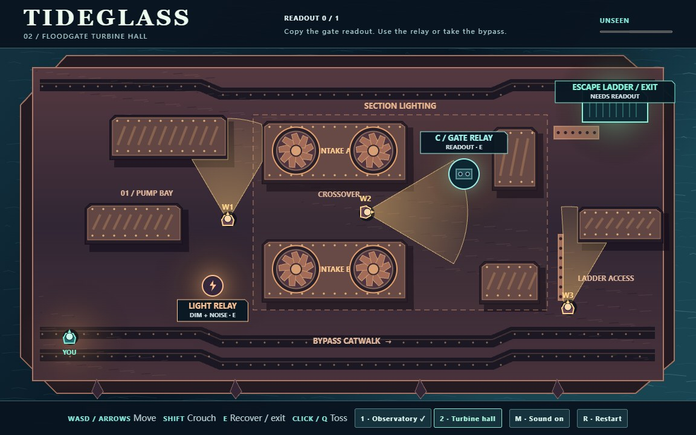

# TIDEGLASS

[中文](#中文) · [English](#english)

## 中文

潮汐观测站潜行游戏。两关均有巡逻守卫、视野遮挡和可恢复的警觉。第二关可在照明继电器和绕行路线之间选择。

### 本地运行

在项目根目录运行 `node serve.ts`，用桌面浏览器打开 `http://localhost:8080`。WASD 或方向键移动，Shift 蹲行，E 互动，鼠标点击或 Q 投掷。

## English

A two-mission stealth game set in a coastal observatory. Use cover and sound distractions, then choose the turbine hall’s dimmed crossover or lit bypass.

### Run locally

Run `node serve.ts` from the repository root and open `http://localhost:8080` in a desktop browser. Move with WASD or arrows, hold Shift to crouch, use E to interact, and click or press Q to throw.

[补充技术说明 / Additional technical notes](README.details.md)

[make.fun 赛事 / Original bounty](https://make.fun/bounty/best-stealth-game-20261121-1759)

## 许可证 / License

MIT. See [LICENSE](LICENSE).

赛事模板组件的授权见 [LICENSE-makefun.txt](LICENSE-makefun.txt)。

Kit components are covered by [LICENSE-makefun.txt](LICENSE-makefun.txt).

